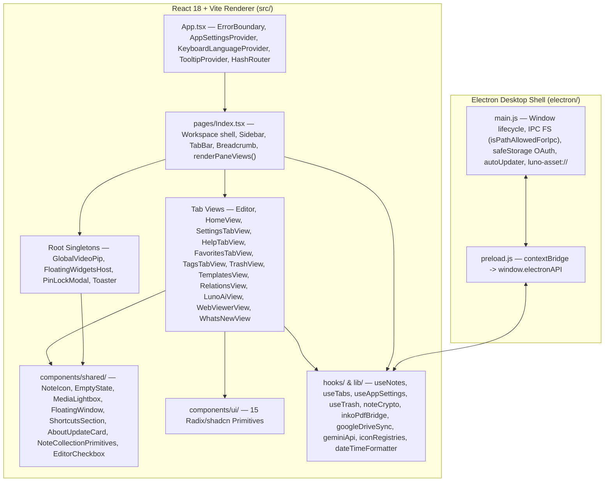

# Luno Note — Architecture Guidelines

> **Purpose**: Authoritative architectural map of **Luno Note** — directory ownership, state & context isolation, pane rendering, CustomEvent contracts, storage schemas, Electron IPC security boundaries, and the mandatory Reuse & Feature Development workflows.

---

## 1. High-Level System Architecture



---

## 2. Directory Structure & Ownership (`LN-ARCH-01`)

| Path | Ownership & Rules |
| :--- | :--- |
| `electron/` | Desktop main process (`main.js`), preload bridge (`preload.js`), and icons. No React/Vite code. |
| `src/pages/` | Top-level routes (`Index.tsx` workspace shell, `NotFound.tsx`). Legacy `#/settings` and `#/help` redirect to `/` via `App.tsx`. |
| `src/components/ui/` | **15 pure Radix/Tailwind design primitives** ONLY (`alert-dialog`, `button`, `context-menu`, `dialog`, `dropdown-menu`, `input`, `label`, `popover`, `select`, `slider`, `switch`, `textarea`, `toast`, `toaster`, `tooltip`). Do NOT add unused shadcn boilerplate or domain components here. |
| `src/components/shared/` | Reusable Luno Note domain components shared across 2+ features (`NoteIcon`, `EmptyState`, `PageLoader`, `MediaLightbox`, `FloatingWindow`, `FloatingWidgetsHost`, `useMarkdownCodeCopyTooltip`, `ShortcutsSection`, `AboutUpdateCard`, `NoteCollectionPrimitives`, `EditorCheckbox`). |
| `src/components/editor/` | Rich editor submodules: `extensions/editorExtensions.ts`, `slashItems.tsx`, `TableInteractiveOverlay.tsx`, `turndownService.ts`, `ImageNodeView.tsx`, `VideoNodeView.tsx`, `AudioNodeView.tsx`, `VideoPlayer.tsx`, `AudioPlayer.tsx`, `GlobalVideoPip.tsx`, `WorkspaceMediaPickerShell.tsx`, `WorkspaceImagePickerDialog.tsx`, `WorkspaceVideoPickerDialog.tsx`, `mediaContextMenuUtils.ts`. |
| `src/components/` | Feature tab views (`HomeView`, `SettingsTabView`, `HelpTabView`, `FavoritesTabView`, `TagsTabView`, `TrashView`, `TemplatesView`, `RelationsView`, `LunoAiView`, `WebViewerView`, `WhatsNewView`, `PdfEditorView`) and workspace chrome (`Sidebar`, `TabBar`, `Breadcrumb`, `WindowControls`, `RightPanel`, `VersionHistoryPanel`, `Editor`). |
| `src/hooks/` | State & effect hooks (`useNotes`, `useTabs`, `useAppSettings`, `useTrash`, `useTranslation`, `useGoogleDriveSync`, `useAppUpdate`, `use-toast`, `use-mobile`). |
| `src/lib/` | Pure business logic, persistence, encryption, sync, AI API, curated icon registries (`iconRegistries.ts`, `iconPacks.ts`), HTML/tab/date utilities (`htmlUtils.ts`, `systemTabs.ts`, `dateTimeFormatter.ts`, `fileIconUtils.ts`, `sanitizeHtml.ts`, `noteCrypto.ts`, `inkoPdfBridge.ts`, `googleDriveApi.ts`, `googleDriveSync.ts`, `geminiApi.ts`). |
| `src/translation/` | `en.ts`, `th.ts` (`TranslationSchema`), `translate.ts` (pure helper + `TranslationKey`), `translations.test.ts` (automated integrity + placeholder + zero-inline-Thai-ternary suite). |
| `docs/standards/` | Permanent engineering, UI/UX, coding, and architecture specifications. |
| `.agents/skills/luno-note-standards/` | Permanent AI agent skill enforcing these standards on every task. |

---

## 3. State Management & Context Isolation (`LN-PERF-02`, `LN-ARCH-02`)

1. **`AppSettingsContext` (`src/hooks/useAppSettings.ts`)**:
   - Owns persisted preferences (`theme`, `darkMode`, `appearanceStyle`, `language`, `fontFamily`, `editorFontSize`, `iconPack`, `showFileIcons`, `dateFormat`, `timeFormat`, `storageMode`, toolbar customization, etc.).
   - Strips local/private fields (`userName`, `geminiApiKey`, `googleDriveClientId`) via `sanitizeWorkspaceSettingsPayload()` before saving workspace `.luno/settings.json`.
   - Updates `document.documentElement.lang` reactively whenever `settings.language` changes.
2. **`KeyboardLanguageContext` (`src/hooks/useAppSettings.ts`)**:
   - Isolated high-frequency context (`useKeyboardLanguage()`) for live Thai/English keyboard layout indicators in `Editor.tsx`. Never merge back into `AppSettingsContext`.
3. **Root-Hosted Global Singletons (`src/pages/Index.tsx`)**:
   - `<GlobalVideoPip />` and `<FloatingWidgetsHost />` mount ONCE at the workspace root so Split View never duplicates floating widgets and tab switching preserves active timers, recordings, calculations, and translations.
4. **Unified Pane Switchboard (`src/pages/Index.tsx`)**:
   - Split Left (`"left"`), Split Right (`"right"`), and Single Main (`"main"`) panes all render through ONE `renderPaneViews(pane)` function. Any new system tab view MUST be added in `renderPaneViews()` and `src/lib/systemTabs.ts` (`SYSTEM_TAB_IDS`) + `NoteIcon.tsx` (`SYSTEM_ICON_KEYS`).

---

## 4. CustomEvent & Breadcrumb Portal Architecture

### Registered CustomEvents
| Event Name | Payload (`detail`) | Producer(s) | Consumer(s) |
| :--- | :--- | :--- | :--- |
| `luno:open-settings` | `SettingsCategory` (optional) | `App.tsx` redirect, `Sidebar`, `Editor` | `Index.tsx` |
| `luno:open-help` | `HelpCategory` (optional) | `App.tsx` redirect, `Sidebar` | `Index.tsx` |
| `luno:filter-notes` | `"all" \| "explore" \| "favorites" \| "tags" \| "trash"` | `HomeView`, `Index.tsx` | `Sidebar.tsx` |
| `luno:reload-web-tab` | `{ tabId: string }` | `TabBar.tsx` | `WebViewerView.tsx` |
| `luno:custom-fonts-changed` | — | `customFontStore.ts` | `useCustomFonts()` |
| `luno:breadcrumb-mounted` / `luno:breadcrumb-unmounted` | `{ paneId: string }` | `Breadcrumb.tsx` | `Editor.tsx` |
| `app:toggle-calculator` / `app:toggle-clock` | — | `Index.tsx`, `Editor.tsx` | `FloatingWidgetsHost.tsx` |
| `app:toggle-translator` | `{ initialText?: string; forceOpen?: boolean; paneId?: string }` | `Index.tsx`, `Editor.tsx` | `FloatingWidgetsHost.tsx` |
| `app:toggle-audio-recorder` | `{ paneId?: string }` | `Editor.tsx` | `FloatingWidgetsHost.tsx` |
| `luno:insert-translation` | `{ text: string; paneId?: string }` | `FloatingWidgetsHost.tsx` | `Editor.tsx` |
| `luno:insert-audio` | `{ src, title, relativeSrc?, blob?, paneId? }` | `FloatingWidgetsHost.tsx` | `Editor.tsx` |
| `luno:fix-language` | `{ handled: boolean }` | `fixLanguageSystem.ts` (`Index.tsx` / Electron IPC) | `Editor.tsx`, `HtmlCodeEditor.tsx` |
| `luno:fix-language-status` | `GlobalFixLanguageStatus` | `Index.tsx` | `SettingsTabView.tsx` |

### Breadcrumb Portal Contract (Preserve Carefully!)
`src/components/Breadcrumb.tsx` renders two portal target containers keyed by `paneId`:
- `id="breadcrumb-save-status-${paneId}"`
- `id="breadcrumb-editor-actions-${paneId}"`

When `Breadcrumb` mounts/unmounts, it dispatches `luno:breadcrumb-mounted` / `luno:breadcrumb-unmounted` so `Editor.tsx` can re-attach its React Portals for save status badges and top-right editor actions in both Single and Split View panes. Never rename or remove these DOM IDs or events without updating both `Breadcrumb.tsx` and `Editor.tsx`.

---

## 5. Persistence & Storage Schemas (`LN-DATA-01`, `LN-BC-01`)

| Layer | Location / Key | Contents & Rules |
| :--- | :--- | :--- |
| **User Notes** | `<workspace>/**/*.md` (`.txt`, `.html`, `.css`, `.js`, `.pdf`, media) | Standard Markdown with YAML frontmatter (`tags`, `icon`, `favorite`); PIN-locked notes use AES-GCM envelopes (`noteCrypto.ts`, v1 & v2 supported, PBKDF2 clamped `100k..2M`). |
| **Workspace Settings** | `<workspace>/.luno/settings.json` | Shareable workspace UI preferences ONLY (`userName`, `geminiApiKey`, `googleDriveClientId` stripped!). |
| **Custom Fonts** | `<workspace>/.luno/fonts/*` + `.luno/fonts.json` (fallback: IndexedDB `luno-note-font-store`) | Sanitized `@font-face` CSS rules (`customFontStore.ts`). |
| **PDF Sidecars** | `<workspace>/.luno/pdf-annotations/*.luno-pdf` + `localStorage` `luno-pdf-annotations:*` & `luno-pdf-bookmarks:*` | Non-destructive vector annotations & bookmarks (`inkoPdfBridge.ts`); annotation and bookmark keys MUST remain disjoint. |
| **App Preferences** | `localStorage`: `notes-app-settings`, `notes-app-tabs`, `notes-app-trash`, `notes-app-favorites-*`, `notes-app-tags-*` | Backward-compatible keys; locked notes NEVER written to `luno_backup_*`. |
| **OAuth Tokens (Electron)** | `<userData>/gdrive-auth.json` | Encrypted at rest via Electron `safeStorage` (reads legacy plaintext transparently). |

---

## 6. Security Boundaries (`LN-SEC-01`, `LN-SEC-02`)

1. **Electron Workspace Confinement (Symlink-Aware)**: `electron/main.js` enforces `isPathAllowedForIpc(targetPath)` on every filesystem IPC handler and `luno-asset://` request, resolving both lexical (`path.resolve`) and real filesystem paths (`resolveExistingRealPath` via `fs.realpathSync.native`) against active/recent workspaces and `userApprovedPaths`, blocking sensitive user/system paths (`isCriticalSystemPath`: `.ssh`, `.gnupg`, `.aws`, `.azure`, `.kube`, `AppData`, `/etc`, `/var`, `/usr`, etc.), skipping symbolic links during directory scans, and validating workspace root promotions via `isAllowedWorkspaceRoot()`.
2. **OAuth 2.0 PKCE + `state` CSRF & Print/Webview Isolation**: `google-oauth-login` generates both PKCE (`code_challenge`) and a cryptographic `state` parameter verified on callback, sanitizes loopback HTML parameters, and sends `X-Frame-Options: DENY` and `X-Content-Type-Options: nosniff`. Hidden `BrowserWindow`s for `print-content` and `export-pdf` run with `sandbox: true` and navigation locked down.
3. **CSP & Protocol Safety**: `luno-asset://` does NOT set `bypassCSP: true`. External file opening rejects all dangerous executable/script extensions (`DANGEROUS_EXTENSIONS`).
4. **Renderer Sanitization Across Imports/Exports**: `sanitizeHtml()` fails closed (`return ""`) and sanitizes all `dangerouslySetInnerHTML` surfaces, `.docx` imports (`docxToHtml`), and PDF/DOC export templates (`generatePdfHtml`, `generateDocHtml`); QR SVG colors and numeric dimensions are validated/clamped; `@font-face` rules escape quotes/control characters and validate base64 font data URLs; `WebViewerView` omits `allow-same-origin` on `data:`/`blob:`/`file:` fallback iframes.
5. **Cloud Privacy**: `uploadDriveAttachmentFile()` keeps uploaded files private to the user's Google Drive (no auto `anyone: reader`); `syncLocalLunoMetaToDrive()` skips `settings.json`, `session.json`, and `*.local`.
6. **API Keys**: Gemini API calls pass keys via `x-goog-api-key` HTTP header (never `?key=` URL query strings).

---

## 7. Mandatory Reuse & Feature Development Workflow

Before creating any component, hook, modal, or utility, follow this exact sequence:

```
1. INSPECT  -> Search src/components/ui/, src/components/shared/, src/components/editor/, src/hooks/, src/lib/
2. COMPARE  -> Find existing features with similar UX (SettingsTabView, FavoritesTabView, TagsTabView, HomeView, TrashView)
3. REUSE    -> Use existing shared component/utility directly if it fits
4. ADAPT    -> Pass props/slots (className, headerExtra, renderThumbnail, etc.)
5. EXTEND   -> Add clean backward-compatible optional props if an existing primitive is 80%+ aligned
6. CREATE   -> Create a new module ONLY when genuinely distinct; place in shared/ if reusable across 2+ features
```

### Adding a New Feature Checklist
1. Check existing patterns (`Inspect → Compare → Reuse`).
2. Design UI using Luno Note tokens (`rounded-2xl`/`rounded-xl`, semantic colors, 7-tier z-index, Tailwind v3 valid classes).
3. Put ALL UI text in both `src/translation/en.ts` and `src/translation/th.ts` (zero `isTh?` ternaries, zero dead `||` fallbacks).
4. If adding a system tab: register in `src/lib/systemTabs.ts`, `src/components/shared/NoteIcon.tsx`, and `renderPaneViews()` in `src/pages/Index.tsx`.
5. If adding an Electron IPC method: add workspace path validation in `electron/main.js`, expose in `electron/preload.js`, and type in `src/vite-env.d.ts`.
6. Verify: `npx tsc --noEmit`, `npm test`, `npm run lint`, `npm run build`, and `node --check electron/main.js`.
